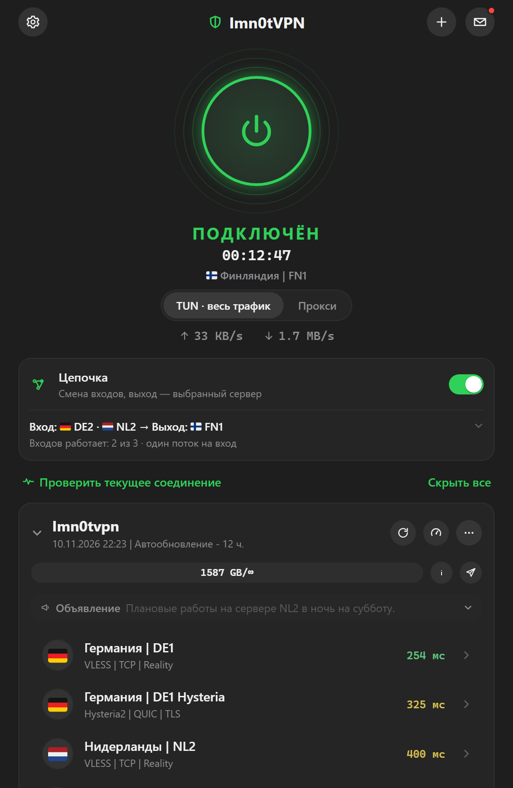
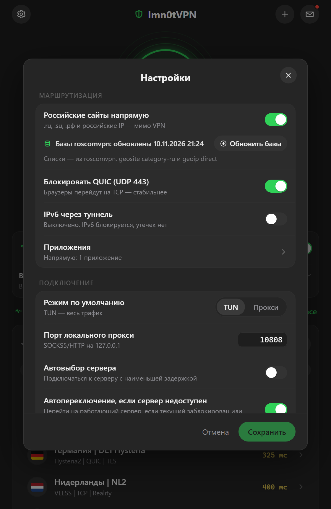
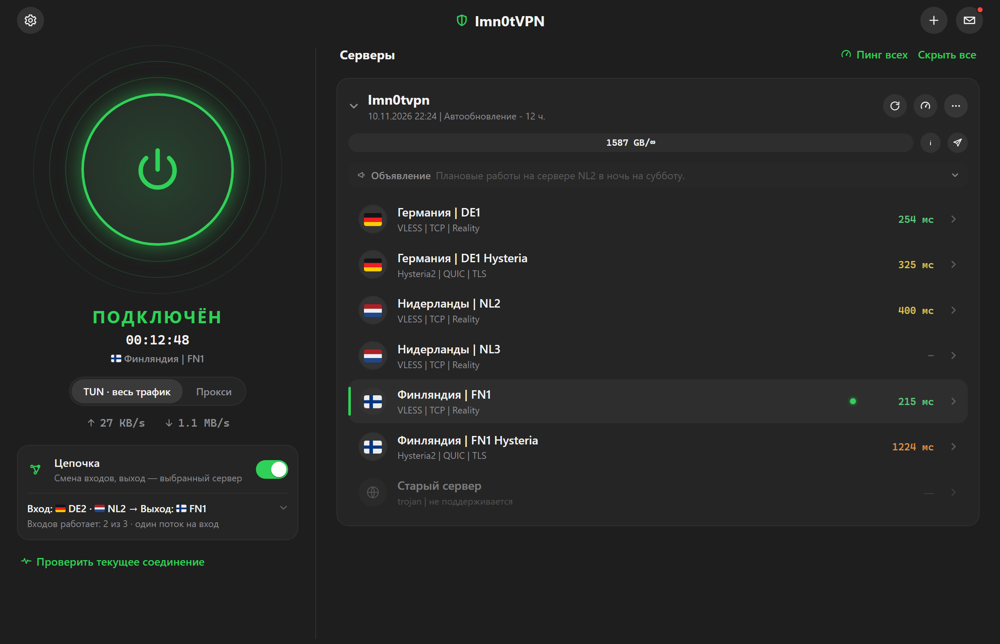

<div align="center">


# Imn0tVPN

**Быстрый и незаметный VPN-клиент для серверов Imn0tVPN — для Windows и macOS**

Своё ядро на Rust: без Xray и sing-box внутри, один небольшой и быстрый движок для обеих платформ.

[](https://github.com/imn0tsad/imn0tvpn-updates/releases/download/v0.2.6/Imn0tVPN_0.2.6_x64-setup.exe)
&nbsp;
[](https://github.com/imn0tsad/imn0tvpn-updates/releases/download/v0.2.6/Imn0tVPN_0.2.6.dmg)

Windows 10 и 11 · x64 · 6 МБ &nbsp;·&nbsp; macOS 14+ · Apple Silicon · 6 МБ

</div>

<p align="center">
  
  &nbsp;&nbsp;
  
</p>

## Возможности

- **Одна кнопка.** Вставили ссылку на подписку — нажали кнопку включения.
- **Весь компьютер через VPN (TUN)** или только программы, которые слушают системный прокси, — переключается на главном экране.
- **Российские сайты — напрямую.** Банки, Госуслуги и другие сервисы, которые не любят зарубежные IP, работают как без VPN. Списки обновляются автоматически.
- **«Цепочка».** Трафик идёт через сменяющиеся входные серверы нашей сети: снаружи не видно, к какому серверу вы на самом деле подключены.
- **Свои правила для программ.** Можно пустить мимо VPN игры или, наоборот, только выбранные программы — через VPN.
- **VLESS Reality и Hysteria 2.** Если сервер недоступен, клиент сам переключится на работающий.
- **Своё ядро на Rust.** Протоколы, маршрутизация и туннель написаны с нуля на Rust: быстро, экономно к памяти и одинаково на Windows и Mac.
- **Обновляется сам (Windows).** Новые версии ставятся из этого репозитория; приложение принимает только установщики, подписанные нашим ключом. На Mac новую версию пока нужно скачать вручную.

<p align="center">
  
</p>

## Установка на Windows

1. Скачайте **[Imn0tVPN_0.2.6_x64-setup.exe](https://github.com/imn0tsad/imn0tvpn-updates/releases/download/v0.2.6/Imn0tVPN_0.2.6_x64-setup.exe)** и запустите.
2. Windows может показать «Система Windows защитила ваш компьютер» — нажмите **Подробнее → Выполнить в любом случае**. Установщик пока не подписан сертификатом.
3. Подтвердите права администратора: они нужны службе, которая управляет туннелем.
4. В приложении нажмите **＋** и вставьте ссылку на подписку из личного кабинета или Telegram-бота.
5. Выберите сервер и нажмите кнопку включения.

Устанавливайте под той учётной записью Windows, под которой будете пользоваться VPN.

## Установка на macOS

1. Скачайте **[Imn0tVPN_0.2.6.dmg](https://github.com/imn0tsad/imn0tvpn-updates/releases/download/v0.2.6/Imn0tVPN_0.2.6.dmg)**, откройте и перетащите Imn0tVPN в папку «Программы».
2. При первом запуске macOS напишет, что не может проверить разработчика. Откройте **«Системные настройки» → «Конфиденциальность и безопасность»** и нажмите **«Всё равно открыть»**. Приложение пока не подписано сертификатом Apple.
3. Приложение попросит пароль администратора, чтобы поставить службу, которая управляет туннелем.
4. Нажмите **＋**, вставьте ссылку на подписку, выберите сервер и нажмите кнопку включения.

## Частые вопросы

<details>
<summary><b>Не подключается в режиме TUN</b></summary>

Скорее всего, включён другой VPN (Happ, v2rayN, Hiddify и т.п.). Два туннеля одновременно не уживаются — закройте другой VPN полностью, включая значок в трее, и подключитесь снова. Приложение подскажет, какой адаптер мешает.
</details>

<details>
<summary><b>VPN подключён, но какая-то программа не открывает сайты</b></summary>

Программа запомнила прокси другого VPN, когда тот был включён. Перезапустите её.
</details>

<details>
<summary><b>Режим «Прокси» пишет, что порт занят</b></summary>

Порт 10808 занят другой программой (чаще всего другим VPN). Закройте её или смените порт в настройках.
</details>

<details>
<summary><b>Антивирус ругается на установщик</b></summary>

Приложение ставит системную службу и сетевой драйвер <a href="https://www.wintun.net/">Wintun</a> — это нормально для VPN. Проверить, что файл не подменён, можно по SHA-256 ниже.
</details>

<details>
<summary><b>Как удалить</b></summary>

«Параметры Windows» → «Приложения» → Imn0tVPN → «Удалить». Служба и драйвер удаляются вместе с приложением, настройки сети возвращаются как были.
</details>

## Проверка файла

```
SHA-256
Windows  2e1050f0898cbe1b16d5c99e60b68f9656ed14a680878346b6a5bd13e49c8aad
macOS    04c24a2554aafb25543c2508c780e330ed0ad8785799d486357b8229ffea8da1
```

Все версии и что в них изменилось — в разделе [Releases](https://github.com/imn0tsad/imn0tvpn-updates/releases).

---

<sub>Установщики лежат в разделе Releases, а здесь — только файл <code>latest.json</code>, по которому приложение узнаёт о новой версии. Исходный код — в закрытом репозитории.</sub>
